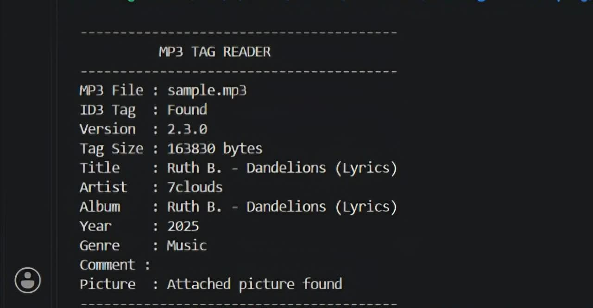
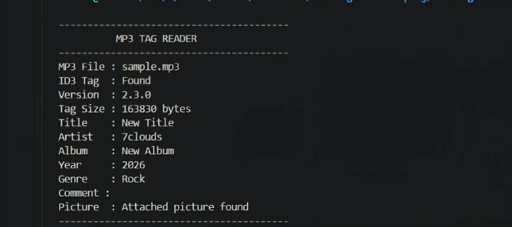

# 🎧 MP3 Tag Reader & Editor

A command-line tool written in **C** that reads and edits **ID3v2.3** metadata in MP3 files. It parses the tag header and frames directly from the raw bytes, with no external libraries.


## ✨ Features

- View ID3v2.3 details: version, tag size, title, artist, album, year, genre, comment
- Detect attached album art (picture frame)
- Edit title, artist, album, year, genre, and comment from the terminal
- Built-in help menu (`-h`)
- Error handling for missing operations, invalid files, and wrong arguments
- Modular design: separate view, edit, and help modules

## 📸 Demo

**Before editing**





**After editing**

```bash
./a.out -e -t "New Title" sample.mp3
./a.out -e -A "New Album" sample.mp3
./a.out -e -y "2026" sample.mp3
./a.out -e -g "Rock" sample.mp3
```





## 🚀 Getting Started

### Requirements

- GCC compiler
- Linux, macOS, or Windows with WSL / MinGW

### Build

```bash
git clone https://github.com/almishamsudheen-ops/mp3-tag-reader.git
cd mp3-tag-reader
gcc main.c edit.c view.c help.c -o a.out
```

### Usage

```bash
# Show help
./a.out -h

# View tags
./a.out -v sample.mp3

# Edit tags
./a.out -e -t "New Title"   sample.mp3
./a.out -e -a "New Artist"  sample.mp3
./a.out -e -A "New Album"   sample.mp3
./a.out -e -y "2026"        sample.mp3
./a.out -e -g "Rock"        sample.mp3
./a.out -e -c "My Comment"  sample.mp3
```

> Use any MP3 file that has ID3v2.3 tags to test.

### Options

| Option | Description |
|--------|-------------|
| `-v` | View MP3 tags |
| `-e` | Edit MP3 tags |
| `-t` | Edit title |
| `-a` | Edit artist |
| `-A` | Edit album |
| `-y` | Edit year |
| `-g` | Edit genre |
| `-c` | Edit comment |
| `-h` | Display help |

## 📁 Project Structure

```
mp3-tag-reader/
├── main.c           # Entry point and argument handling
├── view.c / view.h  # Reads and displays tag data
├── edit.c / edit.h  # Edits tag data
├── help.c / help.h  # Help menu
├── operations.h     # Shared declarations
├── mp3_tag_reader_srs.pdf   # Software requirements specification
└── ID3v2.3TagSpec.pdf       # ID3v2.3 reference
```

## ⚙️ How It Works

An ID3v2.3 tag sits at the start of an MP3 file and begins with a 10-byte header: the `ID3` marker, version, flags, and tag size stored as a **synchsafe integer** (7 bits per byte). After the header come frames, each with a 4-character ID, a size, flags, and data:

| Frame | Meaning |
|-------|---------|
| `TIT2` | Title |
| `TPE1` | Artist |
| `TALB` | Album |
| `TYER` | Year |
| `TCON` | Genre |
| `COMM` | Comment |
| `APIC` | Attached picture |

The program reads each frame, converts sizes from big-endian to little-endian, and prints or rewrites the requested field.

## 📚 What I Learned

- Parsing a binary file format directly from a specification
- Endianness conversion and synchsafe integers
- File I/O with `fopen`, `fread`, `fseek`, `fwrite`
- Splitting a C project into modules with header files
- Command-line argument handling and error checking

## 🔗 Reference

- [ID3v2.3 Tag Specification](https://id3.org/id3v2.3.0)

## 👤 Author

**[Almi Shamsudheen](https://www.linkedin.com/in/almi-shamsudheen-67b4592b2)**

Feedback and suggestions are welcome. Open an issue or connect with me on LinkedIn.

## 📄 License

This project is licensed under the [MIT License](LICENSE).
